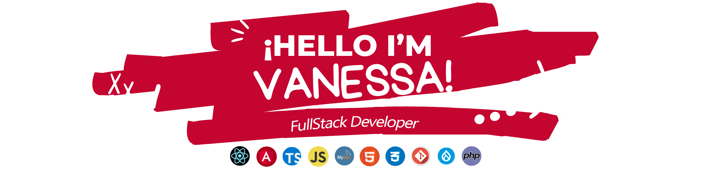

  

  

  
<h2>Sobre mi</h2>

👋 ¡Hola! Soy Vanessa

💻 Soy **Desarrolladora Web Full Stack**, con experiencia en **Drupal y Angular**.

🚀 Me apasiona crear aplicaciones web modernas, escalables e intuitivas, trabajando con **frameworks basados en componentes, gestores de contenido (CMS) y soluciones personalizadas**.

📍 Desde **España** 🇪🇸

✨ Soy una desarrolladora **creativa, resolutiva y autónoma**, a la que le encanta solucionar problemas, aprender nuevas tecnologías y afrontar nuevos retos.

🌱 Siempre estoy buscando mejorar mis habilidades, descubrir nuevas herramientas y escribir código limpio, eficiente y fácil de mantener.

💼 **Abierta a nuevas oportunidades profesionales** donde pueda aportar mis conocimientos, seguir creciendo y participar en proyectos interesantes.

📩 **¿Quieres saber más sobre mí o colaborar en algún proyecto? ¡No dudes en contactar conmigo!** 🤗 

<h2>Mis proyectos</h2>
Mira mis proyectos y pregúntame si quieres más información. </a>  

👇👇👇👇👇👇

<!--
**vanemp21/vanemp21** is a ✨ _special_ ✨ repository because its `README.md` (this file) appears on your GitHub profile.

Here are some ideas to get you started:

- 🔭 I’m currently working on ...
- 🌱 I’m currently learning ...
- 👯 I’m looking to collaborate on ...
- 🤔 I’m looking for help with ...
- 💬 Ask me about ...
- 📫 How to reach me: ...
- 😄 Pronouns: ...
- ⚡ Fun fact: ...
-->
